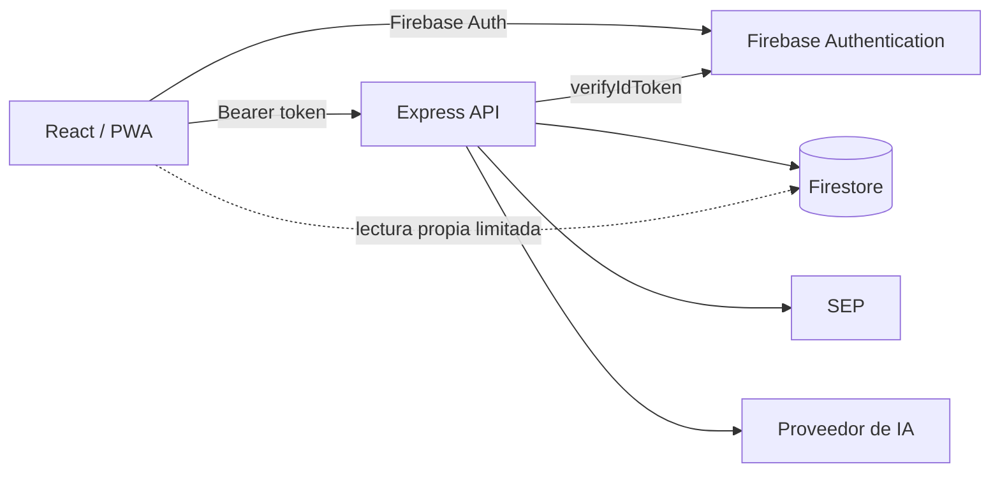

# Arquitectura de AmigoBot 2.0

## Estado actual

AmigoBot es un monolito distribuido en dos aplicaciones:

- `frontend/`: SPA React/Vite desplegable en Vercel, autenticación Firebase y PWA.
- `backend/`: API Express desplegable en Render, Firebase Admin, SEP e integración de IA.

Firestore mantiene identidad de aplicación, vínculos, conversaciones, mensajes, reportes y tareas. Firebase Authentication es la fuente de identidad. El backend es la frontera de confianza para operaciones sensibles.



## Decisión: monolito modular incremental

No se crearán microservicios ni carpetas vacías. Los límites se introducirán cuando un caso de uso cambie, siguiendo capas pequeñas:

```text
module/
  controller     Traducción HTTP; no decide permisos por sí solo
  service        Casos de uso y transacciones
  validator      Esquemas y normalización de entrada
  repository     Consultas y persistencia
  policy         Autorización por actor, recurso y propósito
  integration    Proveedores externos
  tests          Unidad, autorización e integración
```

Mientras las rutas actuales se migren gradualmente, los servicios compartidos viven en `backend/services/`. Ya existen límites comprobables para autenticación, roles, acceso a pacientes, validación, sincronización y serialización pública.

## Mapa de dominios objetivo

| Dominio | Responsabilidad | Estado actual / próximo límite |
|---|---|---|
| auth | Verificar identidad y sesión | `authenticationService`, Firebase Auth |
| identity | Roles, estados y contextos de cuenta | Parcial en `users`; requiere modelo de capacidades |
| users | Perfil personal y preferencias | Parcial; no mezclar con credenciales profesionales |
| memory | Memoria privada controlada | Resúmenes embebidos en conversaciones; pendiente |
| conversations | Chat, mensajes y continuidad | Implementado en `chatRoutes`; separar repositorio gradualmente |
| professionals | Verificación y perfil profesional | Verificación básica; perfil público pendiente |
| patients | Relaciones y consentimientos | Vínculo actual; consentimiento granular pendiente |
| appointments | Disponibilidad y reservas | No implementado |
| clinical-records | Expediente y notas profesionales | Reportes/tareas parciales; falta modelo formal |
| clinical-ai | Asistencia profesional | Análisis interno básico; sin acciones autónomas |
| directory | Publicación y búsqueda | No implementado |
| notifications | Entrega y preferencias | No implementado |
| billing | Suscripciones/facturación | No implementado |
| administration | Verificación, soporte y seguridad | Panel/rutas básicas |
| privacy | Consentimiento, exportación, revocación, retención | Debe preceder Connect y memoria avanzada |
| audit | Eventos de seguridad y trazabilidad | No existe repositorio de auditoría formal |

## Reglas de dependencia

1. Los controladores pueden llamar servicios y validadores, no consultar colecciones nuevas directamente.
2. Las políticas reciben actor y recurso; nunca leen roles proporcionados por el cliente.
3. Repositorios no deciden permisos y no devuelven más campos de los necesarios.
4. Integraciones externas no escriben Firestore directamente.
5. IA recibe vistas minimizadas, no documentos completos.
6. `billing` no depende de conversaciones o memoria.
7. `directory` consume una proyección pública del profesional, nunca su documento de verificación.
8. `clinical-records` no puede importar memoria privada; el intercambio pasa por un consentimiento explícito.

## Identidad y contextos futuros

El campo `role` actual se conserva por compatibilidad, pero no debe crecer indefinidamente. La dirección propuesta es:

- identidad de cuenta estable;
- contextos (`personal`, `professional`, `administration`, futuro `clinic_staff`);
- membresías y capacidades otorgadas por el servidor;
- estados de verificación independientes;
- selección de contexto sin cambiar el propietario de la cuenta.

No se migra aún. La siguiente fase debe definir una lectura compatible que traduzca `role` y `verificationStatus` actuales a capacidades sin reescribir usuarios.

## Configuración y entornos

- Variables secretas solo en el proveedor de despliegue.
- `.env.example` contiene nombres y valores no secretos.
- Node/npm están fijados por `engines`, `.nvmrc`, `.node-version` y `packageManager`.
- `NODE_ENV=production` deshabilita mocks y exige credenciales explícitas.
- Cada nueva variable debe documentar propósito, formato, obligatoriedad y valor seguro por defecto.

## Errores y observabilidad

La API usa mensajes públicos genéricos y no registra conversaciones completas. La evolución recomendada es un error de aplicación con `code`, `httpStatus` y `safeMessage`, más un logger estructurado que elimine tokens, correos, documentos y texto clínico. La monitorización futura debe usar identificadores de correlación y métricas agregadas.

## Migraciones y feature flags

No hay sistema de migraciones hoy. Antes de cambiar esquemas se añadirá:

- registro `schemaMigrations` o herramienta equivalente;
- migraciones idempotentes con dry-run y conteos;
- respaldo y rollback documentados;
- flags evaluadas en backend para capacidades sensibles;
- flags separadas por entorno y nunca usadas como sustituto de autorización.

## Pruebas por frontera

- Unidad: validadores, servicios, políticas y serializadores.
- Autorización: actor A no accede al recurso de B; cada rol/estado.
- Integración: Firebase Emulator y adaptadores falsos para SEP/IA.
- Contrato: request/response de la API sin campos privados.
- E2E staging: registro, sesión, chat, vínculo, tareas y paneles.

## Despliegue y reversión

Frontend y backend se despliegan independientemente. Un cambio de contrato debe ser compatible hacia atrás durante al menos una versión. Las reglas Firebase tienen su propio ciclo de revisión y no se despliegan implícitamente junto con el frontend.
