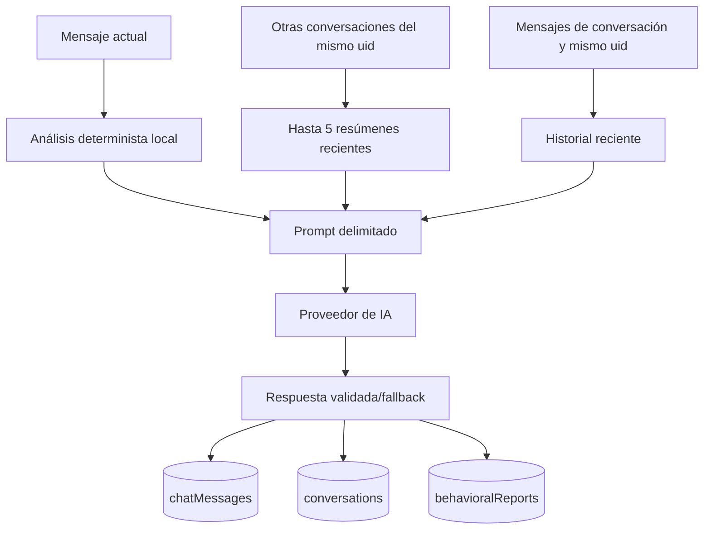

# Análisis del motor de memoria actual

## Resumen

El sistema actual no es un motor de memoria independiente. Reutiliza resúmenes y análisis almacenados en documentos de conversación para construir contexto. Mantiene continuidad básica, pero carece de consentimiento específico, procedencia granular, resolución de contradicciones y eliminación selectiva.

No se sustituye en la Fase 01.

## Flujo actual

### Extracción

`aiService.js` detecta localmente emoción, nivel de riesgo, factores, señales de conducta y tendencia mediante diccionarios/reglas. El proveedor de IA genera o mejora la respuesta dentro de un formato esperado. El resultado produce resumen, cambio conductual y recomendaciones internas.

### Almacenamiento

- El texto de cada intervención se guarda en `chatMessages`.
- Análisis y resumen se guardan en el mensaje del bot.
- El último estado agregado se sobrescribe en `conversations`.
- Se crea un documento en `behavioralReports` con `visibleToPatient: false`.

No existe una colección de memoria, versionado de hechos ni separación entre recuerdo privado y reporte profesional.

### Recuperación

`getMemoryContext(userId, currentConversationId)`:

1. consulta conversaciones del mismo `userId`;
2. excluye la actual;
3. toma documentos con resumen;
4. ordena por actualización;
5. conserva hasta cinco;
6. convierte análisis completos en texto para contexto.

`getRecentConversationMessages` consulta por conversación, filtra otra vez por `userId`, ordena y selecciona mensajes recientes. `aiService` limita cantidad y longitud antes de enviarlos al modelo.

### Información enviada al proveedor

- prompt de sistema;
- mensaje actual;
- hasta doce mensajes recientes recortados;
- hasta cinco fragmentos de memoria recortados;
- etiquetas y contexto conductual derivados.

No se envía intencionalmente el documento de usuario, credenciales profesionales o datos de otros usuarios. Las consultas están ligadas al `uid` autenticado.

## Limitaciones

1. Un resumen generado se trata como recuerdo aunque pueda ser incompleto.
2. No existe procedencia a nivel de afirmación.
3. No hay fecha de validez ni distinción entre pasado y presente.
4. Las contradicciones solo aparecen como texto; no se resuelven ni conservan ambas versiones.
5. El último resumen de una conversación puede sobrescribir contexto anterior.
6. No hay confirmación/corrección del usuario.
7. No existe eliminación selectiva de una memoria.
8. No hay presupuesto por sensibilidad ni propósito.
9. Los análisis internos y la memoria están acoplados al documento de conversación.
10. La recuperación por texto concatenado puede contaminar el contexto y repetir inferencias.

## Riesgos de privacidad

- Una inferencia puede convertirse en contexto futuro sin confirmación.
- Un cambio de relación profesional no borra ni revoca la memoria privada.
- Compartir una conversación bajo el modelo actual puede revelar análisis derivados.
- El texto resumido sigue siendo información personal sensible.
- Borrar la interfaz de una conversación no equivale a borrar mensajes, reportes y memoria derivada; no hay flujo de borrado actual.
- Un prompt injection puede intentar reinterpretar memoria, aunque no puede alterar permisos del backend.

## Arquitectura futura propuesta

### Modelo `memoryItems`

Cada elemento debería incluir:

- `userId` propietario;
- `type`: `semantic`, `episodic`, `temporal` o `relational`;
- `content` estructurado y una representación para búsqueda;
- `sourceType` y `sourceId`;
- `observedAt`, `validFrom`, `validUntil`;
- `confidence` y `confirmationStatus`;
- `sensitivity`;
- `status`: activo, reemplazado, disputado o eliminado;
- `supersedes`/`contradicts`;
- versión de extractor y timestamps.

### Ingesta

1. El mensaje queda en conversaciones.
2. Un extractor genera candidatos, no hechos definitivos.
3. Se aplican esquema, deduplicación y clasificación de sensibilidad.
4. Elementos sensibles o de baja confianza requieren confirmación.
5. La escritura es idempotente y conserva procedencia.

### Recuperación

1. Autorizar al actor y propósito.
2. Filtrar siempre por propietario y estado activo.
3. Aplicar tiempo, sensibilidad y consentimiento.
4. Recuperar un número pequeño de candidatos.
5. Reordenar por relevancia, actualidad y confianza.
6. Construir contexto con citas internas de procedencia.
7. No mezclar memoria privada en herramientas profesionales sin consentimiento específico.

### Contradicciones

Una afirmación nueva no sobrescribe silenciosamente la anterior. Se marca la relación, se prioriza la más reciente/confirmada para respuesta y se permite al usuario corregir. La IA no decide por sí sola cuál dato personal es verdadero.

### Eliminación

- El usuario puede olvidar un elemento o una categoría.
- La eliminación invalida índices y cachés derivados.
- Los jobs de borrado son idempotentes y auditables sin conservar el contenido borrado.
- Retención clínica, si aplica, se modela aparte; no convierte memoria privada en expediente.

## Plan de adopción seguro

1. Crear contratos y pruebas con almacenamiento falso.
2. Añadir colección nueva sin leerla en producción.
3. Activar extracción de candidatos para cuentas de prueba mediante flag.
4. Construir UI de revisión/corrección/eliminación.
5. Habilitar recuperación limitada en staging.
6. Comparar respuestas con y sin memoria y evaluar fugas/contradicciones.
7. Migrar solo información confirmada; no copiar automáticamente todos los resúmenes heredados.
